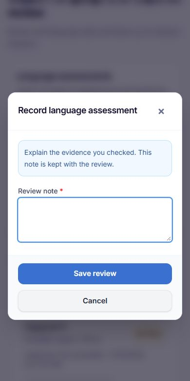
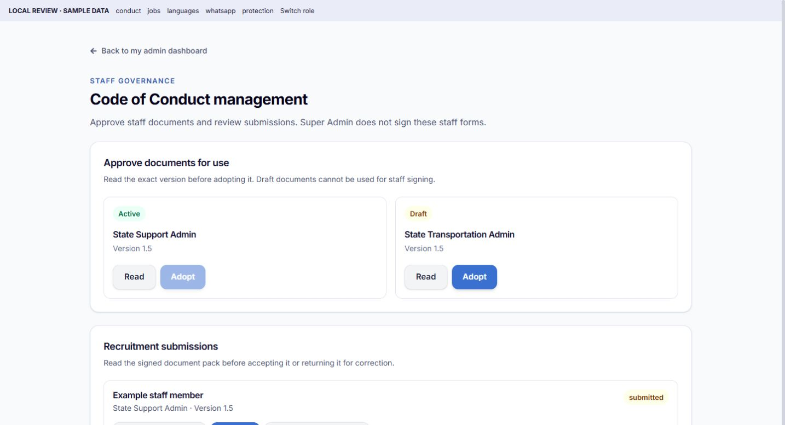

# UI, verification and registration review — 13 November 2026

## What was reviewed

The review covered the work changed from 2–13 November 2026. The source inventory contained 78 web UI files and 59 mobile UI files. Shared controls were checked too. Existing working screens were kept. This was a review of the recent work and the existing project tests, not a promise that every possible bug in every feature has been found.

The website and the native app have separate components. Android and iOS share the React Native screens and styles in RentalHubMobile.

## Fixed first: landlord verification

This fix was deployed separately in web/server commit 3df8d64 and mobile commit c6adcab before the layout work.

1. The verification queue used to hide accounts whose identity status was not_submitted. Landlord filtering can now show these incomplete records. The status filter defaults to All.
2. Users → Verify now opens a required approval-note box. Other web and mobile approval screens also send the note to the existing endpoint.
3. Failed approvals keep the note open so the administrator can correct it or retry.
4. Missing document/photo steps are explained. A missing face photo still blocks approval. No real account was approved during testing.

The read-only production check found one incomplete landlord record with an identity document and no face photo at the time of the check. That person must complete the live face-photo step in Profile. The note form does not bypass this rule.

## Layout corrections

- Code of Conduct, background jobs, language reviews, WhatsApp support and property protection now use clear headings, cards, status labels, empty states and consistent spacing.
- Super Admin sees management/review controls rather than personal staff language availability or personal conduct signing.
- Recruitment review notes and interview dates use labelled dialogs rather than browser prompts. Interview and opportunity actions keep their existing API calls.
- Shared web popups render outside dashboard cards, in the centre of the viewport. They have a scrollable body, keyboard focus, Escape handling and save-in-progress protection. MFA stays above ordinary dialogs.
- Identity review popups also render outside their transformed dashboard cards. This prevents them being positioned inside a card instead of the screen.
- Customer support forms, case tools, customer details and state/customer dashboards use consistent borders and mobile tap targets.
- Service tracking text, registration price details and mobile support metadata were made easier to read. Service badges can wrap on narrow screens. Property-update and fumigation text fields now use the shared input font component.
- On Welcome, flexGrow plus space-between spread the sections across the available height. The content now flows from the top with natural scrolling. The language-to-hero spacing is approximately 24–34 layout units across the existing size variants. There are no negative-margin positioning fixes.
- The full-width language control has a consistent 72-unit minimum height and smaller padding. Previous compact overrides used different sizes. Text can still grow for accessibility.
- The Career Opportunities card now has a 64-unit minimum height across size variants. It stays secondary to Create an account, can stack when narrow, and keeps its navigation and subtle branded effect.
- Welcome headings and actions remain centred. Changing Arabic back to English no longer moves the account-button arrow. The obsolete RTL-only arrow-position style was removed.
- Existing Home hero/request-card centring and Careers layouts were retained where already correct.
- Recruitment controls no longer use 10px text for action labels and have comfortable tap targets.

## Survey question 13: confirmed cause and repair

Question 13 is the last question in Part A for both tenants and landlords.

The global input cleaner removed object keys containing a dot. Real survey answer keys contain dots, for example L1.12 and T1.12. Requests returned HTTP 200, but their answers had been removed. The completion endpoint then correctly returned PART_A_INCOMPLETE. The production checks found successful-save HTTP counts followed by completion failures, and an active landlord response with no first, twelfth or thirteenth answer saved. No personal answers were read or changed during these checks.

The server now keeps only exact, known questionnaire answer keys, only inside answers, only on the existing survey save/public submission/public draft/staff paper-entry routes. Values are still cleaned. Unknown IDs, operator keys, nested answer objects and dotted fields elsewhere remain blocked. Both tenant and landlord Part A tests preserve all 13 answers through the real middleware.

The shared Android/iOS flow now waits for earlier saves, saves the newest answer, and only then asks the server to complete the section. It no longer hides a failed final save or claims success after a failed completion. A failed save stays on the question and allows retry without losing the current answers. The web final-save path also no longer hides save errors.

The server repair benefits the old APK too. Answers already deleted by the old cleaner cannot be reconstructed. If the survey was closed before a successful save, missing answers need to be entered again.

## Landlord dashboard access

Add Property is a main landlord dashboard card and opens the existing AddProperty screen. Support, Disputes and Property Reports also remain visible without opening More. The existing property tools and navigation were preserved. A source-contract test checks that these cards are outside the More-only branch and that Add Property uses the right route.

## Email verification

- The registration phone-code step explains that email verification uses a separate link after the account is created.
- Android/iOS shows an email notice after account creation using the server's delivery result. A failed send is described as a failed send, not as delivery.
- Unverified tenant/landlord dashboards show a persistent email reminder and a Verify email action. The web reminder is also visible during the first survey.
- The verification screen receives the customer's email without putting it into a public URL.
- The wording is complete in English, French, Arabic, Hausa, Yoruba, Igbo, Russian and Chinese.
- The existing Resend delivery service is reused. Opening a dashboard does not automatically send another email.
- The web email-link page no longer stores an undefined sign-in token when the server requires a normal sign-in. Staff MFA and sign-in requirements remain intact.

## Other functional bugs found while checking the new screens

Property-protection staff pickers and landlord registration's agent assignment used two user columns that do not exist on production: assigned_state_id and assigned_lga_name. The queries now derive the expected values from the existing state, city and LGA fields. The real database compiled all four corrected queries. State/LGA limits, independent-inspector checks and the existing state-wide assignment fallback remain in place.

iOS update checks were comparing the iPhone build with the Android build number. They now use the iOS release track. Publishing Android 1.0.65 does not advertise a non-existent iPhone update.

## Checks and results

| Check | Result |
| --- | --- |
| Full backend suite on the server | 233 passed: 214 service tests plus 19 root tests |
| Full web suite on the server | 214 passed in 40 files |
| Final affected language-review checks | 2 passed |
| New update-track regression checks | 5 passed |
| Shared mobile functional checks | 24 passed, including survey save/retry, email notices, support send/retry, property-protection contracts, approval note and dashboard entry points |
| Language round trips | All 8 locales; 7 screen sizes; 2 font scales |
| Typography/source check | 231 screen/component files passed |
| Tour checks | 87 steps; 8 locales; 32 roles; routing/target checks passed |
| Registration controls | Tenant/landlord consent, fields and payment-selection checks passed |
| Live SQL compilation | 4 corrected queries passed without reading customer records |
| Live survey-cleaner proof | All 13 required answers retained for tenant and landlord |
| Final web build | Passed in 5.78 seconds |
| Android release build | BUILD SUCCESSFUL in 31m 40s; release lint passed |
| APK signature | Valid v2 signature; same existing release certificate |
| iOS JavaScript bundle | Passed; 8,025,851-byte bundle |
| Public website/API health | HTTP 200; both RentalHub workers online |
| Public download | Version, byte count and SHA-256 match the signed local APK |
| Repeated update check | Android 1.0.65/build76 false; older 1.0.64/build75 true; iOS 1.0.3/build13 false |

Some full web runs on Windows exceeded the local 5-second test limit while release builders were running. Those runs were not counted as passes. The unchanged default full suite passed on the server. Existing dependency deprecation/chunk-size warnings remain; they were not hidden or treated as build failures.

## Visual checks and limits

The source inventory was reviewed, but every screen was not opened on a physical phone. Representative privileged screens were rendered locally with sample data and no live account writes. Conduct layout overflow checks passed at 320, 375, 390, 768, 1024 and 1440px. Mobile-sized support, jobs, property protection and centred-dialog views were also inspected. Public Careers was inspected at desktop and mobile widths. Native verification used the shared source checks, behaviour tests and release/bundle builders.

No real payments, identity-provider charges, staff signatures, account approvals or customer messages were submitted during QA. The one-day session limit, MFA, required identity photo, role checks, paid registration rules and dispute conversation structure were preserved.

Sample preview of the centred note popup:

Sample preview of the conduct management layout:

## Release and deployment

- Android: **1.0.65 / build 76**, package com.rentalhubng.
- Download: https://rentalhub.com.ng/api/downloads/app?v=1.0.65
- APK size: **109,289,783 bytes**.
- SHA-256: **61aa4b2a331001c41664eada99a7f4ed9014d67a8494cd7e6af33711f05427e4**.
- Certificate SHA-256: **be593ddf8cc4bc731d682390be4d92b9e763441725da368c37c0ca6443a6dd9d**.
- Mobile source commit: **0092424**; web/server functional source: **3462670**, including recent layout commit 790c9e3.
- iOS source: **1.0.65 / build 70**. Shared fixes and its JavaScript bundle are ready. A signed IPA was not built or published from Windows. A Mac/Xcode signing build and device check are still required for an iPhone release. The public iOS track was correctly left at its existing published release.
- Website and backend were deployed. Only RentalHub PM2 workers 2 and 3 were reloaded. Other hosted applications were not restarted.
- New migrations: **none**. New environment variables: **none**. No manual server commands are needed for these deployed fixes.
- Previous website/source backup: /var/backups/rentalhub/ui-survey-1.0.65-20261113T210539Z.
- Previous APK backup: /var/backups/rentalhub/release-1.0.65-20261113T212326421Z.

The Android phone must install 1.0.65 to receive its new cards and email/save-retry UI. Installing over the existing app uses the same signing identity. The server-side survey correction is already available to the older app.

## Exact web/server files changed after the landlord fix

- RentalHubMobile
- client/src/components/RegistrationPhoneVerification.jsx
- client/src/components/admin/AdminDashboardGate.test.jsx
- client/src/components/admin/RecruitmentAdminTab.jsx
- client/src/components/admin/SupportCustomerCard.jsx
- client/src/components/admin/SupportLanguageDesk.jsx
- client/src/components/admin/SupportLanguageDesk.test.jsx
- client/src/components/admin/UsersTab.identity.test.jsx
- client/src/components/admin/UsersTab.jsx
- client/src/components/admin/VerificationsTab.jsx
- client/src/components/admin/VerificationsTab.queue.test.jsx
- client/src/components/common/DisputeHandoverPanel.jsx
- client/src/components/common/EmailVerificationNotice.jsx
- client/src/components/common/EmailVerificationNotice.test.jsx
- client/src/components/common/FeaturePage.jsx
- client/src/components/common/FloatingContactWidget.jsx
- client/src/components/common/InputDialog.jsx
- client/src/components/common/LanguageSkillsField.jsx
- client/src/components/common/MfaCodeModal.jsx
- client/src/components/common/MfaEnrollment.test.jsx
- client/src/components/common/Modal.jsx
- client/src/components/common/Modal.test.jsx
- client/src/components/common/PropertyCaseTools.jsx
- client/src/components/common/SupportContactForms.jsx
- client/src/components/survey/SurveyWizard.jsx
- client/src/pages/Dashboard.jsx
- client/src/pages/PropertyProtection.jsx
- client/src/pages/PropertyProtection.test.jsx
- client/src/pages/Register.jsx
- client/src/pages/VerifyEmail.jsx
- client/src/pages/VerifyEmail.test.jsx
- client/src/pages/admin/AdminConduct.jsx
- client/src/pages/admin/AdminLayout.jsx
- client/src/pages/admin/BackgroundJobs.jsx
- client/src/pages/admin/StateAdminDashboard.jsx
- client/src/pages/admin/SupportLanguages.jsx
- client/src/pages/admin/WhatsAppSupport.jsx
- client/src/utils/registrationEmailCopy.cjs
- config/middleware/inputSanitizer.js
- routes/mobileDiagnostics.js
- services/authService.js
- services/propertyProtectionInspections.js
- services/propertyProtectionService.js
- tests/services/mobileUpdateTracks.test.js
- tests/services/propertyProtectionStaff.test.js
- tests/services/registrationAgentScope.test.js
- tests/services/surveySanitizer.test.js

## Exact mobile files changed after the landlord fix

- android/app/build.gradle
- app.json
- ios/RentalHubMobile.xcodeproj/project.pbxproj
- package-lock.json
- package.json
- scripts/test-dashboard-entrypoints.cjs
- scripts/test-registration-email.cjs
- scripts/test-survey-progress.cjs
- scripts/test-whatsapp-support.cjs
- scripts/verify-language-layout.cjs
- src/components/RegistrationPhoneVerification.js
- src/components/admin/OperationNoteModal.js
- src/components/common/ChoiceChips.js
- src/components/common/EmailVerificationNotice.js
- src/components/common/LanguageDropdown.js
- src/components/common/PremiumLayout.js
- src/components/common/SupportContactForms.js
- src/components/common/SupportCustomerCard.js
- src/components/properties/PropertyUpdateModal.js
- src/context/AuthContext.js
- src/i18n/registrationEmailCopy.cjs
- src/screens/auth/RegisterScreen.js
- src/screens/auth/WelcomeScreen.js
- src/screens/dashboard/DashboardScreen.js
- src/screens/services/DriverTripConsoleScreen.js
- src/screens/services/FumigationLiveTrackingScreen.js
- src/screens/services/FumigationTeamConsoleScreen.js
- src/screens/services/ServiceTrackingCentreScreen.js
- src/screens/services/TransportationLiveTrackingScreen.js
- src/screens/shared/AdminConductScreen.js
- src/screens/shared/PropertyProtectionScreen.js
- src/screens/shared/SupportLanguageScreen.js
- src/screens/shared/SurveyScreen.js
- src/screens/shared/WhatsAppSupportScreen.js
- src/services/surveyService.js
- src/utils/registrationEmailNotice.js

## Review artefacts added

- docs/ui-and-registration-review-2026-11-13.md
- docs/review-2026-11-13/after-review-modal-390.png
- docs/review-2026-11-13/after-conduct-1440.png

No audio files were added to these commits.

## New source and test files

Web/server:

- client/src/components/common/EmailVerificationNotice.jsx
- client/src/components/common/EmailVerificationNotice.test.jsx
- client/src/components/common/FeaturePage.jsx
- client/src/components/common/Modal.test.jsx
- client/src/utils/registrationEmailCopy.cjs
- tests/services/mobileUpdateTracks.test.js
- tests/services/propertyProtectionStaff.test.js
- tests/services/registrationAgentScope.test.js
- tests/services/surveySanitizer.test.js

Shared Android/iOS:

- scripts/test-dashboard-entrypoints.cjs
- scripts/test-registration-email.cjs
- scripts/test-survey-progress.cjs
- src/components/common/ChoiceChips.js
- src/components/common/EmailVerificationNotice.js
- src/i18n/registrationEmailCopy.cjs
- src/utils/registrationEmailNotice.js
